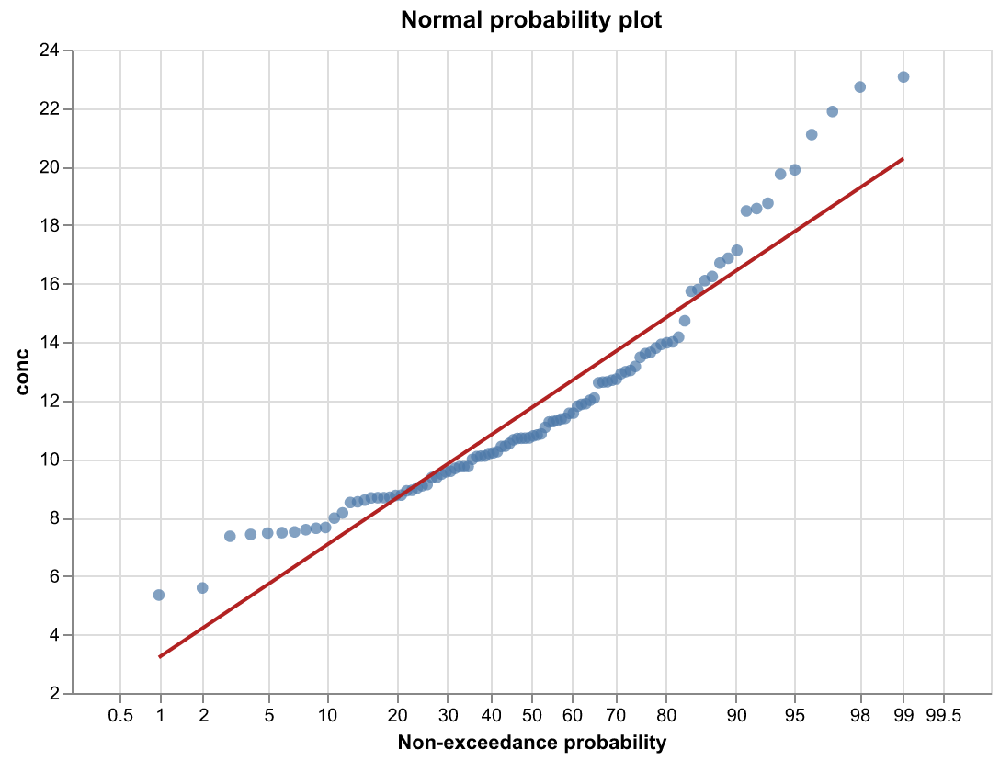

Probability plots in Altair / Vega-Lite
=======================================

.. note::

    This is a standalone sketch for people working in Vega-Lite, not part of
    the mpl-probscale API. It is not run during the docs build and is not
    covered by the test suite. Altair is not a dependency of this package.

Vega-Lite has no probit scale, but a normal probability plot can be built
from two pieces:

1. Plotting positions are computed inside the spec and passed through
   Vega's ``quantileNormal`` function to get z-scores.
2. Axis ticks are placed at the z-scores of familiar percentages and
   relabelled with ``cumulativeNormal``, the inverse transform.

A least-squares line fit in z-space serves as the normal-distribution fit.

The full script (``uv add altair vl-convert-python`` to run it):

.. literalinclude:: altair_probscale.py
    :language: python

Limitations compared to mpl-probscale: only the normal distribution, no
confidence bands, fixed tick locations, and a single plotting-position
formula (via the ``a`` argument).
